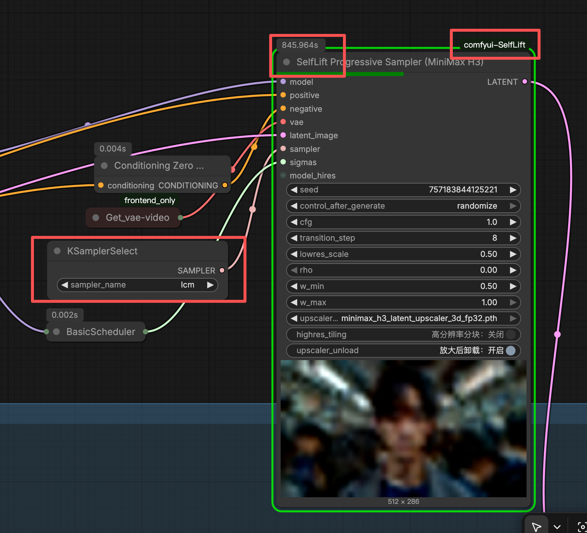

# comfyui-SelfLift-with-lcm

[English README](README.md) · [License](LICENSE)



ComfyUI 渐进分辨率采样：前期去噪步骤跑低分辨率，把结果提升到全分辨率并收尾——免训练加速生成。

基于 [SelfLift 论文](https://arxiv.org/abs/2609.02036)（SelfLift-zero，面向 rectified-flow 图像模型），外加论文未验证的 MiniMax H3 音视频实验性适配，以及 [TST](https://arxiv.org/abs/2609.08505) 时间注意力校正的 H3 实验性移植。

> **状态：研究原型。** 图像采样器严格贴合论文，是本项目中最成熟的部分。H3 音视频路径与 TST 节点属实验性质，验证较少，且依赖 ComfyUI 内部接口，可能随版本变动而失效。请预期有毛刺；提 issue 之前先跑一遍最小复现。

---

## 安装

```bash
cd ComfyUI/custom_nodes
git clone https://github.com/henry19801109/comfyui-SelfLift-with-lcm
```

重启 ComfyUI。节点出现在 `selflift` 分类下。

`psutil` 是唯一的额外依赖，只被可选的显存诊断（`SELFLIFT_MEMORY_LOG=1`）使用：

```bash
pip install psutil
```

### 环境要求

- 支持 `comfy.samplers`、`comfy.model_sampling`、`comfy.patcher_extension` 的 ComfyUI 版本（近期 nightly 均可）。
- H3 采样器与 TST 节点需要带 MiniMax H3 支持的 ComfyUI（`comfy.ldm.minimax`）。没有的话 H3 节点会给出明确报错，其余节点照常可用。
- 外部 H3 upscaler（可选）：从 [LBH-123-AI/Minimax_h3_latent_Upscaler](https://huggingface.co/LBH-123-AI/Minimax_h3_latent_Upscaler) 下载 checkpoint，放入 `ComfyUI/models/latent_upscale_models/`。

## 节点一览

| 节点 | 类型 | 作用 |
| --- | --- | --- |
| **SelfLift Progressive Sampler (Image, Euler/LCM)** | `MODEL` + `LATENT` → `LATENT` | 论文的 SelfLift-zero，面向 rectified-flow 图像骨干，支持 Euler 与 LCM 采样器 |
| **SelfLift Progressive Sampler (MiniMax H3)** | `MODEL` + `LATENT` → `LATENT` | 实验性音视频适配，另含可选的学习式 latent upscaler 与高分辨率分块 |
| **H3 Temporal State Transport (TST)** | `MODEL` → `MODEL` | H3 视频的免训练时间稳定性校正，可配合任意标准采样节点 |

采样器节点使用与 `SamplerCustom` 相同的 `sampler`/`sigmas` 接口；`KSamplerSelect` 必须选标准 `euler`，调度器沿用模型默认（其它采样器会被拒绝）。

---

## SelfLift Progressive Sampler (Image)

论文 SelfLift-zero，用于 rectified-flow 图像骨干。接入 4D 图像 latent（如 *Empty Latent Image*）和模型所属 VAE。

| 参数 | 默认 | 含义 |
| --- | --- | --- |
| `transition_step` | 0 | 低分辨率阶段步数。**0 = 自动**：保持论文"四分之三跑低分辨率"的比例，能精确复现论文取值（Z-Image-Turbo 8 步取 6，FLUX.2-Klein 4 步取 3），并把 6 步调度解析为 4 低 + 2 高。其它数值按原样使用 |
| `lowres_scale` | 0.5 | 前缀的空间缩放 |
| `rho` | 0.3 | 向像素 VAE 锚点修正的高风险位置比例。FLUX.2-Klein 取 0.4；0 关闭锚点 |
| `w_min` / `w_max` | 0.5 / 1.0 | 选中位置的修正强度范围 |
| `latent_upsample` | nearest | 直接提升插值；可选 `bilinear` |
| `model_hires`（可选） | — | 高分辨率阶段使用的另一个模型（如不同 checkpoint 或 LoRA 组合）。必须与 `model` 同架构、同 latent 格式；低分辨率前缀始终用 `model` |

过渡不增加去噪评估次数：N 步调度仍严格等于 N 次 NFE；`rho=0` 以外的情况多一次 VAE 解码 → 上采样 → 重编码往返。

### LCM 采样

两个节点都支持标准 `lcm` 采样器，可用于少步蒸馏模型（LCM、SDXL-Lightning、SD-Turbo）。两个采样族的单步推进方式不同：

- **Euler** 对导数做积分，因此被丢弃的过渡更新要从低分辨率状态重新构建。
- **LCM** 把状态替换成干净估计，再在下一个 sigma 上重新加噪，因此过渡是从修正后的端点重建同样的「替换 + 加噪」步骤。

重建过程通过模型自身的 `noise_scaling` 表达，sigma 族（flow 与 DDPM）的差异由模型处理，而非由本插件处理。因此 `lcm` 采样器可以跑任意模型，rectified-flow 和 DDPM 都可以。

使用要求：

- 采样器必须选 `KSamplerSelect` 的标准 **`lcm`**。
- 若要达到蒸馏模型应有的画质，需先把模型用 **`ModelSamplingDiscrete` → `lcm`** 打补丁（即 *ModelSamplingDiscrete (advanced)* 节点）。该补丁安装 LCM 的 `c_skip`/`c_out` 混合和蒸馏时间步调度。它属于**画质**问题而非采样器的前提——采样器跑在未打补丁的模型上时，SelfLift 会打一条警告日志。
- `cfg` 建议保持较低（1.0–2.0），蒸馏模型是在无引导条件下训练的。

典型的 6 步配置：`steps=6`、`sampler=lcm`、`transition_step=0`（自动 → 4 低 + 2 高）、`cfg=1.0`、调度器用 `simple` 或 `normal`。

接法：把 `KSamplerSelect → lcm` 接到采样器节点的 `sampler` 输入；蒸馏模型则先把模型经过 **ModelSamplingDiscrete (advanced)** 并把 `sampling` 设为 `lcm`。

注意 LCM 路径会为过渡和高分辨率阶段偏移噪声种子——LCM 每步都会抽取新噪声，而低分辨率前缀已经消耗掉了属于它的那部分序列。

---

## SelfLift Progressive Sampler (MiniMax H3)

H3 音视频实验性适配（论文未验证）。两种模式：

- **外部 upscaler（默认）**：安装 H3 checkpoint 且 `rho=0`——学习式纯 latent 提升。实用默认，但不是 SelfLift-zero。
- **SelfLift-zero**:`upscaler_model=none` 且 `rho>0`。H3 建议起点：`rho=0.6`、`w_min=w_max=1`（见"诊断 H3")。

额外输入：`upscaler_model`、`upscaler_unload`（默认开启：放大完立即把 upscaler 从显存卸载，再进入高分辨率阶段）与 `highres_tiling`（实验性：把高分辨率阶段切成 1–8 个空间块以省显存；只保留首块音频，块间无全局注意力，不支持 ControlNet，画质和速度可能变化）。

### 可选 H3 upscaler

从 [LBH-123-AI/Minimax_h3_latent_Upscaler](https://huggingface.co/LBH-123-AI/Minimax_h3_latent_Upscaler) 下载，放入 `ComfyUI/models/latent_upscale_models/` 后重启。节点默认选第一个文件名含 `h3` 的模型，找不到则为 `none`(nearest 提升）。

## H3 Temporal State Transport (TST)

`MODEL` → `MODEL` 补丁节点，推理时改善 H3 视频的时间稳定性——免训练、免额外模型，运行开销约 1–2%。主要对付：帧间闪烁或变形的小细节（logo、画面文字、纹理）、人物与服装的身份漂移、不符合物理的运动。可配合任意标准采样节点，不限于 SelfLift 采样器。它不能凭空生成模型没有的细节。

| 参数 | 默认 | 含义 |
| --- | --- | --- |
| `tau` | 0.2 | 校正强度。0.2 为推荐值；0.5 已明显过强。0 关闭校正但保留诊断 |
| `log_diagnostics` | 开 | 每次模型前向输出一行 `[H3 TST]` 诊断 |

原理一句话：不盲目加强跨帧注意力，而是先测量帧级注意力算子的带符号"谱张力"，只校正失衡的头——过混合的锐化、碎片化的软化——并在更深层和更早去噪步施加更强校正。理论和推导见[论文](https://arxiv.org/abs/2609.08505)。

诊断行包含：latent 帧数、每帧网格行数、调用内校正前/后的张力、平均 γ、被校正头比例、TST 自身耗时。真实 H3 运行上，校正方向与精确注意力算子的逐头一致率为 89–100%。调试时可在启动 ComfyUI 前设 `SELFLIFT_TST_EXACT=1`，在每次前向的一层上输出精确算子对比（很慢，仅调试用）。

限制：仅支持 MiniMax H3（其它模型静默跳过）;**与 `highres_tiling` 不兼容**（跳过并给出控制台警告）。

## 诊断 H3

固定同一 prompt 和 seed,`transition_step=6`、`lowres_scale=0.5`：

| 测试 | `upscaler_model` | `rho` | 权重 | 含义 |
| --- | --- | ---: | --- | --- |
| 直接路径 | `none` | 0 | 任意 | 只用 nearest latent 提升 |
| 像素路径 | `none` | 1 | `1 / 1` | 纯 H3 VAE 像素锚点 |
| 论文式 SelfLift-zero | `none` | 0.3 | `0.5 / 1` | 论文图像参数 |
| H3 强修正 SelfLift-zero | `none` | 0.6 | `1 / 1` | H3 实测起点 |
| 外部提升器 | H3 checkpoint | 0 | 任意 | 学习式 H3 提升 |

单 seed 对照结果：原生基线和纯像素锚点干净；nearest 路径出现大范围伪影，论文图像参数（`rho=0.3`）仍保留大部分；`rho=0.6` 且 `w_min=w_max=1` 消除了主要伪影。仅为单 seed 证据——H3 的直接提升误差比论文图像骨干更广，建议从强修正开始，过度平滑再降低。

## 日志与环境变量

- `[SelfLift plan]` — 实际的低/目标 latent 形状、NFE 数、过渡 sigma、启用的提升路径
- `[SelfLift timing]` — 逐步与分阶段（低分辨率/过渡/高分辨率）墙钟耗时
- `[SelfLift upscaler]` / `[SelfLift tiling memory]` — upscaler 推理与分块的内存估算（启发式，非实测峰值）
- `[H3 TST]` — TST 逐前向诊断
- `SELFLIFT_TIMING_SYNC=1` — CUDA 同步计时（更慢，仅诊断用）
- `SELFLIFT_MEMORY_LOG=1` — 阶段边界的主机/显存快照
- `SELFLIFT_DEBUG=1` — 把过渡中间结果导出 PNG 到 `debug/`（慢且耗内存）
- `SELFLIFT_TST_EXACT=1` — TST 精确算子校准探针（仅调试用）

## 注意事项与限制

- 只接受标准 `euler`（`s_churn=0`）和 `lcm` 采样器，其它采样器会被拒绝。`euler` 要求 rectified-flow 模型；`lcm` 可跑任意模型。
- 两个采样器都支持 `noise_mask`（Set Latent Noise Mask 语义：1 = 生成，0 = 保留原内容；需要有初始化 latent 才有可保留的内容）。任意分辨率的 mask 都会缩放到 latent 网格，时间长度为 1 时全帧共享。保留区域在每一步都被钉到原始 latent，artifact-aware 修正也只作用于生成区域。`noise_mask` 与 `highres_tiling` 不兼容。
- 必须使用采样模型所属的 VAE，保证像素锚点处于同一 latent 空间。
- H3 的 768 像素短边在 `lowres_scale=0.5` 时为 384 像素，可能超出骨干训练分布——请按模型自行验证。
- SelfLift-rich（蒸馏提升器 + On-Policy Self Recovery）需要训练，不在本插件内。
- H3 路径上，2× 空间提升约等于 3.9× 的注意力 token 增长，因此高分辨率阶段的单步成本并不比低分辨率阶段低——加速来自低分辨率前缀，而非提升本身。

## 参与贡献

欢迎提 issue 和 PR。请附上 ComfyUI 版本、模型 checkpoint，以及完整控制台日志（其中 `[SelfLift plan]` 那一行是最有价值的单行信息）。

如果改动了采样器或过渡逻辑，请说明你在哪个模型、哪个采样器上验证过——Euler 与 LCM 两条路径除入口外几乎没有共用代码。

## 引用与致谢

- SelfLift 论文：[SelfLift: Accelerating Few-Step Diffusion via Self-Recovering Resolution Transition](https://arxiv.org/abs/2609.02036)
- TST 论文与代码：[Temporal State Transport in Video Generation](https://arxiv.org/abs/2609.08505)，[lytang63/temporal-state-transport](https://github.com/lytang63/temporal-state-transport)
- 可选 MiniMax H3 latent upscaler 权重与下载：[LBH-123-AI/Minimax_h3_latent_Upscaler](https://huggingface.co/LBH-123-AI/Minimax_h3_latent_Upscaler)
- 原始 ComfyUI 集成与推理实现：[LBH-123-AI/Comfyui_Minimax_h3_latent_Upscaler](https://github.com/LBH-123-AI/Comfyui_Minimax_h3_latent_Upscaler)

感谢 LBH-123-AI 公开 MiniMax H3 latent upscaler 权重和 ComfyUI 实现，使本插件能够提供可选的 H3 学习式提升路径。该外部 lifter 与 SelfLift 论文中的 SelfLift-rich 模型仍是彼此独立的实现。

```
@article{wen2026selflift,
  title={SelfLift: Accelerating Few-Step Diffusion via Self-Recovering Resolution Transition},
  author={Wen, Tingyan et al.},
  journal={arXiv:2609.02036},
  year={2026}
}
```

## 许可证

[MIT](LICENSE) © 2026 HERVINAI
